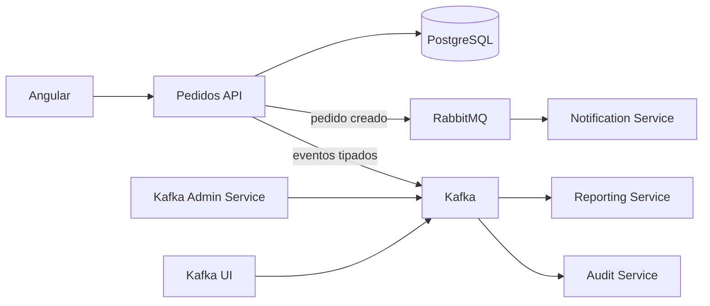

# Evaluación 3 - Apache Kafka en Pedidos360

## Objetivo

Kafka complementa a RabbitMQ sin sustituirlo. RabbitMQ conserva el flujo operacional de notificaciones, mientras Kafka distribuye eventos de negocio durables a servicios independientes de reportería y auditoría.

## Arquitectura



## Tópicos

| Tópico | Particiones | Réplicas | Retención | Cleanup policy | Finalidad |
|---|---:|---:|---:|---|---|
| `pedidos.eventos` | 3 | 1 | 7 días | `delete` | Alimentar métricas y reportería |
| `pedidos.auditoria` | 3 | 1 | 30 días | `delete` | Mantener trazabilidad operativa |

El factor de replicación es 1 porque el entorno académico levanta un solo broker. En producción se recomienda un clúster de tres brokers, factor 3 y `min.insync.replicas=2`.

## Contrato del evento

Los productores publican JSON tipado con estos campos:

- `eventId`: UUID único para trazabilidad.
- `eventType`: `PEDIDO_CREADO` o `PEDIDO_ESTADO_ACTUALIZADO`.
- `pedidoId`: clave de negocio y clave Kafka, lo que conserva el orden por pedido.
- `correoCliente`, `estado` y `total`: datos del flujo.
- `occurredAt`: fecha UTC del evento.
- `schemaVersion`: versión del contrato.

## Productores y consumidores

- El backend publica cada evento en los dos tópicos mediante `KafkaTemplate`.
- El grupo `pedidos-reporteria` consume `pedidos.eventos` y calcula conteos, ventas y estados.
- El grupo `pedidos-auditoria` consume `pedidos.auditoria` y registra los últimos 100 eventos.
- Los grupos tienen responsabilidades distintas, por lo que ambos reciben su propia copia del evento.
- Si se levantan varias instancias de un servicio con el mismo group ID, Kafka distribuye las tres particiones entre ellas.

## Estabilidad y errores

- El productor usa `acks=all`, idempotencia y tres reintentos.
- Los consumidores validan el payload antes de procesarlo.
- El commit es por registro y no automático.
- Los errores transitorios se reintentan tres veces con espera de un segundo.
- Los payloads inválidos no se reintentan y quedan registrados con tópico, partición y offset.
- Kafka y RabbitMQ se publican de forma asíncrona para no detener el CRUD ante una falla temporal de mensajería.

## Administración

Base URL: `http://localhost:8085/api/kafka`.

| Método | Ruta | Acción |
|---|---|---|
| `GET` | `/topics` | Lista tópicos, particiones y réplicas |
| `POST` | `/topics` | Crea un tópico con configuración |
| `GET` | `/topics/{nombre}/config` | Inspecciona la configuración |
| `PUT` | `/topics/{nombre}` | Aumenta particiones y actualiza retención/cleanup |
| `DELETE` | `/topics/{nombre}` | Elimina un tópico |
| `GET` | `/consumer-groups` | Lista los grupos de consumidores |

Ejemplo de creación:

```bash
curl -X POST http://localhost:8085/api/kafka/topics \
  -H "Content-Type: application/json" \
  -d '{"nombre":"pedidos.prueba","particiones":3,"factorReplicacion":1,"retencionMs":86400000,"cleanupPolicy":"delete"}'
```

## Guion de demostración

1. Ejecutar `docker compose up --build`.
2. Abrir Kafka UI en `http://localhost:8086` y mostrar los dos tópicos con tres particiones.
3. Crear un pedido desde Angular en `http://localhost:8081`.
4. Mostrar que RabbitMQ recibió el evento para notificaciones.
5. Abrir `/api/reportes/metricas` y comprobar el aumento de `pedidosCreados` y `ventasAcumuladas`.
6. Abrir `/api/auditoria/eventos` y localizar el mismo `eventId` y `pedidoId`.
7. Abrir `/api/kafka/consumer-groups` y mostrar los dos grupos.
8. Crear y eliminar `pedidos.prueba` con la API administrativa.

## Correspondencia con la pauta

| Indicador | Evidencia en el proyecto |
|---|---|
| Cliente Kafka completo | `application.yml`, `KafkaConfig` y variables Docker |
| DTO tipado | `PedidoKafkaEvent` en productor y consumidores |
| Dos tópicos | `pedidos.eventos` y `pedidos.auditoria` |
| Productores | `KafkaEventPublisher` |
| Consumidores | `ReporteEventConsumer` y `AuditoriaEventConsumer` |
| Manejo de errores | `DefaultErrorHandler`, validación, logs y reintentos |
| Parámetros de tópicos | Particiones, réplicas, retención, cleanup e ISR |
| Consumer groups | `pedidos-reporteria` y `pedidos-auditoria` |
| Administración | `KafkaAdminController` y Kafka UI |
| Infraestructura | Zookeeper, broker y Kafka UI en Docker Compose |
